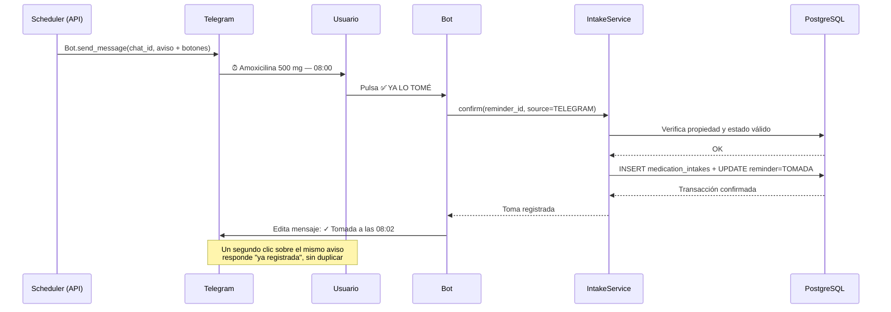
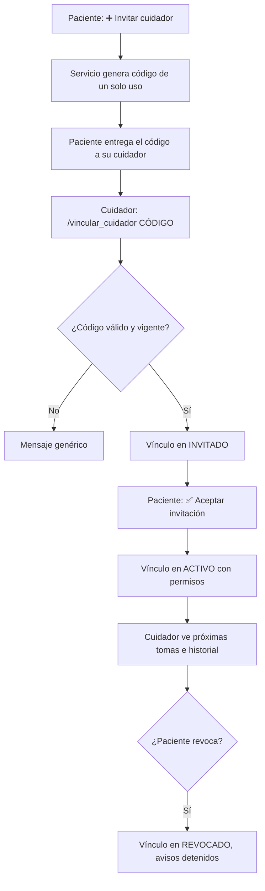
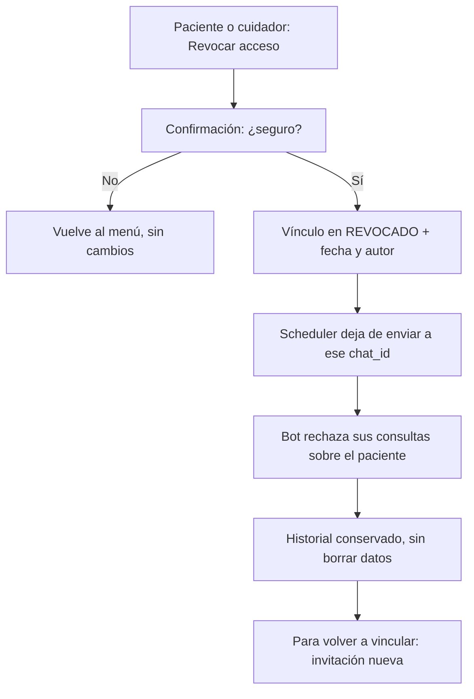

# ESPECIFICACIÓN DEL BOT DE TELEGRAM — DosisAlerta

Documento de diseño funcional y técnico del bot oficial de
DosisAlerta. Especificación para guiar la implementación de la
Fase 6. No es código: no crea modelos, migraciones ni handlers.

Estado del documento: 2026-11-11. Fase 1 cerrada (commit
`819c44b`); PostgreSQL 17.11 verificado funcionando en el PC;
Fase 2 **sin autorizar y sin iniciar**. Todo lo que aquí se marca
como acordado existe en la documentación de Fase 0
(`docs/architecture/`, `docs/database/MODELO_DATOS.md`); lo que se
marca como **PROPUESTO** es diseño nuevo de este documento y
requiere decisión antes de implementarse. No se marca como
cumplido lo que no existe.

## 0. Identidad del bot y estado real

| Dato | Valor |
|---|---|
| Nombre | DosisAlerta |
| Username | @DosisAlertaBot |
| Enlace | https://t.me/DosisAlertaBot |
| Descripción, About y foto de perfil | Configurados en BotFather (según el equipo, 2026-11-11) |
| Comando /start | Registrado en BotFather |
| Token (`TELEGRAM_BOT_TOKEN`) | **PENDIENTE en `.env`**: verificado el 2026-11-11, el valor está vacío en el PC. El bot existe en Telegram, pero el proyecto aún no tiene su token. Debe añadirse a `.env` antes de la Fase 6. Nunca se escribe en código, documentación, logs ni capturas. |
| `TELEGRAM_BOT_USERNAME` en `.env.example` | Dice `dosisalerta_bot`; el username real es `DosisAlertaBot`. Telegram no distingue mayúsculas en usernames, pero se recomienda unificar `.env.example` a `DosisAlertaBot` para no confundir. |
| Librería | python-telegram-bot, por polling. **No instalada en Fase 1**: `backend/pyproject.toml` solo tiene FastAPI, Uvicorn, Pydantic, python-dotenv y tzdata. La versión se fija en la Fase 6, no se inventa aquí. |

## 1. Filosofía de diseño

El bot está diseñado principalmente para **adultos mayores**.
De esa decisión salen todas las reglas siguientes, que son
obligatorias en cada pantalla:

1. **Navegación mediante botones.** Ninguna función exige
   escribir comandos. Los comandos (`/start`, `/vincular`,
   `/medicamentos`, `/proximas`, `/historial`) existen como
   atajo, pero cada función debe alcanzarse también por botón.
2. **Mensajes cortos, claros y amigables.** Una idea por mensaje.
   Frases en presente, sin jerga técnica ni códigos internos.
   Los errores se explican en lenguaje normal ("No encontré ese
   medicamento") y nunca muestran trazas, códigos HTTP ni
   identificadores internos.
3. **Alto contraste y lenguaje sencillo.** Texto grande y legible
   (lo que permite Telegram), palabras comunes, números y horas
   siempre en el mismo formato (`08:00`, no `8`).
4. **Pocas opciones por pantalla.** Máximo 4 botones por mensaje
   en el menú principal y 3 en un recordatorio. Si una lista es
   larga, se pagina de 5 en 5 con botones "‹ Anterior" y
   "Siguiente ›".
5. **Botón de volver al menú principal.** Toda pantalla que no sea
   el menú principal lleva un botón "🏠 Menú principal". Nunca hay
   callejones sin salida.
6. **Confirmación antes de cambiar algo.** Crear, modificar,
   pausar o cancelar un tratamiento o medicamento siempre muestra
   un resumen y pide "✅ Confirmar" o "❌ Cancelar".
7. **El bot nunca modifica una prescripción por su cuenta.**
   Solo registra lo que el usuario (o su cuidador autorizado, ver
   §4) confirma explícitamente, y solo dentro de lo que el
   tratamiento ya prescribe. No sugiere dosis, no cambia horarios
   y no interpreta síntomas.

## 2. Menú principal

Se abre con `/start` (usuario vinculado) y con el botón
"🏠 Menú principal". Cada opción muestra su contenido y sus
acciones; entre paréntesis se indica si es requisito acordado
(RF) o diseño propuesto en este documento.

### 2.1. 💊 Mis medicamentos — ACORDADO (RF16, RF18)

- Contenido: lista de los medicamentos propios del usuario, con
  nombre, presentación, concentración y unidad. Solo los activos;
  los desactivados se ven en "Ver desactivados".
- Acciones por medicamento: "Ver" (detalle y tratamientos donde
  se usa), "Editar" (nombre, presentación, concentración, unidad,
  notas), "Desactivar".
- Acción general: "➕ Nuevo medicamento" (crea con el mismo
  servicio y validaciones que la web, RF18).
- Navegación: de vuelta al menú principal; desde el detalle, a la
  lista.

### 2.2. ⏰ Próximas tomas — ACORDADO (RF16, RF09)

- Contenido: próximos recordatorios ordenados por fecha y hora,
  con medicamento, dosis prescrita y tratamiento. Por defecto,
  las tomas de hoy y mañana.
- Acciones por toma: "✅ Tomada" (registra la toma, RF11) y
  "⏰ Posponer" (15, 30 o 60 minutos, RF12). No se puede confirmar
  una toma futura fuera de su ventana: el servicio rechaza la
  confirmación si el recordatorio no está en estado enviable.
- Navegación: de vuelta al menú principal.

### 2.3. 🗂️ Mis tratamientos — PROPUESTO (base: RF16, RF18)

- RF16 acuerda "cancelación de tratamientos" desde el bot y RF18
  "crear y modificar medicamentos y tratamientos desde el bot",
  pero no existe una pantalla de tratamientos acordada. Se propone
  esta sección para no obligar al usuario a ir a la web.
- Contenido: tratamientos con estado (`ACTIVO`, `PAUSADO`,
  `COMPLETADO`, `CANCELADO`), fecha de inicio y fin opcional,
  y sus medicamentos con dosis.
- Acciones: "➕ Nuevo tratamiento", "Pausar", "Reanudar",
  "Cancelar". Pausar o cancelar muestra un resumen y pide
  confirmación; al cancelar, los recordatorios pendientes se
  cancelan y el historial se conserva (RF08).
- Navegación: de vuelta al menú principal.

### 2.4. 📋 Mi historial — ACORDADO (RF16, RF13; cifras en Fase 7)

- Contenido: tomas registradas con fecha, hora y origen (`WEB` o
  `TELEGRAM`), incluidas las perdidas y las pospuestas. Filtros
  por medicamento y por periodo (hoy, esta semana, este mes).
- El porcentaje de cumplimiento es de la Fase 7 (RF14); el bot lo
  muestra cuando esa fase exista, no antes.
- Navegación: de vuelta al menú principal.

### 2.5. 👨‍👩‍👧 Mi familiar o cuidador — APROBADO v1 (2026-11-11)

- Decisión oficial del líder del proyecto (2026-11-11): los
  familiares y cuidadores están incluidos en la versión 1. Un
  paciente puede vincular uno o varios cuidadores y un cuidador
  puede estar vinculado a uno o varios pacientes, siempre con
  autorización explícita. Requisitos RF20–RF22; modelo en
  `docs/database/RELACIONES_CUIDADORES.md`.
- Contenido: lista de cuidadores vinculados, qué puede ver y
  hacer cada uno, y los botones "➕ Invitar cuidador" y "Revocar
  acceso". Cada cuidador ve solo lo que el paciente le autorizó
  (ver §4).

### 2.6. ⚙️ Configuración — PROPUESTO (base: RF03)

- RF03 acuerda el perfil con zona horaria configurable (por
  defecto `America/Bogota`), pero no una pantalla de ajustes en
  el bot. Se propone: "🕐 Mi zona horaria" (cambiarla recalcula
  solo los recordatorios `PENDIENTE` futuros, RNF04) y
  "🔕 Silenciar avisos por hoy" (no borra recordatorios, solo
  retrasa su envío según la regla de la Fase 5; si no se aprueba,
  no se implementa).
- Navegación: de vuelta al menú principal.

### 2.7. 🆘 Necesito ayuda — PROPUESTO

- No está en los requisitos. Se propone por la filosofía de
  diseño (§1): un mensaje corto con qué hace el bot, cómo
  vincular Telegram, cómo confirmar una toma y cómo contactar al
  cuidador o al equipo. No es soporte médico: nunca da consejos
  de salud, solo ayuda a usar el bot.
- Navegación: de vuelta al menú principal.

## 3. Recordatorios

### 3.1. Envío de notificaciones — ACORDADO (RF17, RNF03)

- El **único emisor de avisos es el scheduler** (proceso API,
  Fase 5). El proceso bot **nunca** envía recordatorios por su
  cuenta: así un aviso no puede salir dos veces por dos caminos
  distintos.
- El aviso llega a la hora programada al `chat_id` vinculado.
  Contenido del mensaje: medicamento, dosis prescrita, horario y
  tratamiento. Ejemplo de formato (texto, no diseño final):

```text
⏰ Es hora de su medicamento

💊 Amoxicilina 500 mg — 1 cápsula
🕐 Hoy, 08:00
🗂️ Tratamiento: Infección respiratoria
```

- Si el usuario no tiene Telegram vinculado, no hay aviso: la
  web muestra el recordatorio pendiente, pero no se inventa otro
  canal.

### 3.2. Botones del aviso — APROBADO (2026-11-11)

Los botones aprobados son exactamente dos (RF12, RF17):

| Botón | Acción (servicio) | Efecto en BD |
|---|---|---|
| ✅ YA LO TOMÉ | `IntakeService.confirm(reminder_id, source=TELEGRAM)` | Crea la fila en `medication_intakes` (`taken_at` en UTC, `source=TELEGRAM`) y marca el recordatorio `TOMADA`, en una sola transacción |
| ⏰ RECORDARME DESPUÉS | Posponer (RF12) | El original queda `POSPUESTA` y se crea un recordatorio hijo (`parent_reminder_id`), con 15, 30 o 60 minutos de retraso a elegir |

**Botón "NO LO HE TOMADO": ELIMINADO DEFINITIVAMENTE
(2026-11-11).** No se implementa. No existe un registro de toma
negativa ni un estado adicional para representar esa acción. Los botones solo los puede pulsar el paciente: si un
cuidador pulsa YA LO TOMÉ o RECORDARME DESPUÉS sobre un
recordatorio del paciente, el servicio lo rechaza con 403 y lo
registra como `ACCESS_DENIED` (no existe permiso para confirmar
tomas). El aviso que recibe el cuidador no lleva botones. El
modelo de datos no tiene ningún estado para una toma negada: una
toma solo existe como fila en `medication_intakes` (confirmada) o
como recordatorio `PERDIDA` cuando pasa la ventana de gracia (30
minutos, Fase 5). Si el usuario no toma la dosis, simplemente no
pulsa nada y el recordatorio pasa a `PERDIDA` fuera de gracia,
que es lo que el historial ya sabe representar. En ningún caso
se crea una toma negativa ni se cambia una prescripción por no
pulsar un botón.

### 3.3. Registro de fecha y hora

- La toma se registra con `taken_at` en UTC (`timestamptz`) y se
  muestra al usuario en su zona horaria. El mensaje editado tras
  confirmar dice, por ejemplo: "✓ Tomada a las 08:02".
- El origen queda registrado (`WEB` o `TELEGRAM`, RF11) y es
  visible en el historial web y en el bot.

### 3.4. Prevención de confirmaciones duplicadas — ACORDADO

- `medication_intakes.reminder_id` es UNIQUE: una toma por
  recordatorio, como máximo. La transición de estado la impone el
  servicio, no solo la BD: no hay vuelta desde `TOMADA`,
  `PERDIDA` ni `FALLIDA` a un envío nuevo del mismo recordatorio.
- El bot edita el mensaje tras la primera confirmación ("✓
  Tomada a las 08:02") para que no se pueda pulsar dos veces con
  efecto. Si llega un callback duplicado (doble clic, reintento
  de Telegram), el servicio lo resuelve como "ya registrada" y
  responde el mismo mensaje, sin crear otra toma.
- La prueba de aceptación de la Fase 5 lo exige: "confirmar dos
  veces crea una sola toma".

### 3.5. Reintentos y manejo de errores — ACORDADO (Fase 5)

- Ventana de gracia: 30 minutos. Vencido fuera de gracia, el
  recordatorio pasa a `PERDIDA`.
- Reintentos con backoff: máximo 3 fallos claros (la API de
  Telegram devuelve error, por ejemplo chat no encontrado o bot
  bloqueado) y máximo 3 intentos ambiguos (la respuesta se perdió
  tras enviar). Cada intento queda en `notification_logs` con
  `attempted_at` siempre y `sent_at` solo si Telegram confirma
  con `telegram_message_id`.
- Un intento ambiguo queda `AMBIGUA` y lo decide la
  reconciliación al arrancar o en el siguiente ciclo, nunca se
  inventa como enviado. Un recordatorio `FALLIDA` se muestra como
  tal en la web; no se reenvía en silencio días después.
- Garantía honesta (corrección de Fase 0): **entrega al menos
  una vez y efecto exactamente una vez**. No se promete envío
  exactamente una vez, porque la API de Telegram no lo permite
  asegurar.

### 3.6. Lo que Telegram nunca hace

- No modifica dosis, horarios ni tratamientos por su cuenta.
- No interpreta síntomas ni recomienda medicamentos.
- No borra recordatorios, tomas ni historial (`MODELO_DATOS.md`
  §6: nunca `DELETE` en estas tablas; cancelar es cambiar
  `status`).

## 4. Pacientes y cuidadores — APROBADO v1 (2026-11-11)

> Decisión oficial del líder del proyecto (2026-11-11): los
> familiares y cuidadores están incluidos en la versión 1. Un
> paciente puede vincular uno o varios cuidadores autorizados y
> un cuidador puede estar vinculado a uno o varios pacientes,
> siempre mediante autorización explícita. Requisitos RF20–RF22.
> El diseño completo del modelo está en
> `docs/database/RELACIONES_CUIDADORES.md`: 3 tablas nuevas
> (`caregiver_links`, `caregiver_audit_log` y
> `caregiver_link_attempts`) junto a las 11 originales (total:
> 14 tablas). En la migración inicial de la Fase 2 se crean 13;
> `caregiver_link_attempts` se migra en la Fase 6. En la
> arquitectura de Fase 0 esta relación no existía; esta sección
> es la decisión que la incorpora.

### 4.1. Principios

1. El paciente es el dueño de sus datos. Nadie ve sus
   medicamentos sin su autorización explícita.
2. El cuidador **nunca** puede modificar dosis prescritas ni
   indicaciones médicas por iniciativa propia, ni suspender
   tratamientos por decisión propia (ver §4.4). Por defecto, no
   puede modificar nada: cada permiso se concede explícitamente.
3. Toda acción del cuidador queda auditada con quién, cuándo y
   qué hizo.
4. La identificación es por **ID numérico de Telegram**
   (`telegram_user_id` y `chat_id`), nunca por username, que
   puede cambiar, ni por nombre, que se repite. El cuidador debe
   ser usuario registrado; para recibir avisos por Telegram debe
   tener además su propia cuenta vinculada (RF15).

### 4.2. Vinculación mediante código temporal de un solo uso

Se reutiliza el mecanismo ya acordado para vincular la propia
cuenta (RF15, `ARQUITECTURA.md` §5.1, `MODELO_DATOS.md` §7.3),
adaptado a invitar a otra persona:

1. El paciente, desde la web o desde el bot, pulsa "➕ Invitar
   cuidador". El servicio genera un código de un solo uso (10
   caracteres, alfabeto sin confusiones, módulo `secrets`,
   expira en 15 minutos) y guarda **solo su HMAC-SHA256** con el
   secreto independiente `CAREGIVER_LINK_SECRET` (decisión
   2026-11-11; distinto de `TELEGRAM_LINK_SECRET` y de
   `JWT_SECRET`). La invitación crea la fila en `caregiver_links`
   en estado `INVITADO` con `caregiver_user_id` NULL: en ese
   momento el cuidador aún no está identificado.
2. El paciente entrega el código a su cuidador por el canal que
   elija (en persona, por llamada). El código en texto plano
   nunca se guarda, nunca va en logs y nunca se devuelve por API.
3. El cuidador abre el bot y envía `/vincular_cuidador CÓDIGO`
   (o pulsa el botón de invitación con el código). Cada intento
   se registra en `caregiver_link_attempts` antes de validar.
   El servicio compara con `hmac.compare_digest`, valida
   vencimiento y límites de intentos (5 fallos por `chat_id` en
   15 minutos, como en RF15) y, si todo vale, **vincula la
   identidad del cuidador a la invitación** (la fila ya existe
   como INVITADO; no se crea un vínculo nuevo en este paso).
4. **Autorización explícita del paciente:** el vínculo no queda
   activo hasta que el paciente lo confirma (botón "✅ Aceptar
   invitación" en su propio chat, o en la web). Invitación y
   aceptación son dos pasos distintos: que el cuidador tenga el
   código no basta.
5. Un código usado, vencido o revocado no se puede reutilizar y
   devuelve el mismo mensaje genérico que un código inexistente,
   para no revelar qué códigos existen.

### 4.3. Tablas nuevas — APROBADO v1, se crean en la Fase 2

Diseño completo en `docs/database/RELACIONES_CUIDADORES.md`.
Resumen:

- **`caregiver_links`**: el vínculo. Columnas: `id`,
  `patient_user_id`, `caregiver_user_id` (NULL hasta que el
  cuidador presenta el código), `status`
  (`INVITADO`/`ACTIVO`/`REVOCADO`), `invite_code_hash`,
  `invite_expires_at`, `failed_attempts`, `last_failed_at`,
  los 8 permisos booleanos (§4.4), `invited_at`, `invited_by`,
  `accepted_at`, `revoked_at`, `revoked_by`, `created_at`,
  `updated_at`. Unicidad por índices únicos parciales: una sola
  fila no revocada por pareja; al revincular se crea fila nueva
  (auditoría 2026-11-11).
- **`caregiver_audit_log`**: la auditoría. Columnas:
  `caregiver_user_id` (NULL en eventos de invitación sin
  cuidador identificado), `patient_user_id`, `action`,
  `target_type`, `target_id`, `details` JSONB (minimización de
  datos: nunca tokens, secretos, códigos, dosis ni indicaciones),
  `result` (`OK`/`DENEGADO`), `created_at`. La tabla
  `notification_logs` audita envíos, no acciones de personas:
  no basta para esto.
- **`caregiver_link_attempts`**: antifraude de las invitaciones
  (tabla 14, aprobada 2026-11-11). Cada intento de código se
  registra con `chat_id`, hash del código intentado y motivo,
  antes de saber si el código es correcto. Su migración física
  es de la Fase 6.

### 4.4. Permisos — APROBADO v1 (2026-11-11)

Los 8 permisos son independientes y todos empiezan en NO. Cada
uno se concede explícitamente por el paciente, por separado, y se
puede revocar por separado sin tocar los demás:

| Permiso | Qué permite |
|---|---|
| Consultar medicamentos | Ver la lista y el detalle de los medicamentos del paciente |
| Consultar tratamientos | Ver tratamientos y sus estados |
| Consultar horarios | Ver los horarios de cada medicamento |
| Consultar próximas tomas | Ver los próximos recordatorios ordenados |
| Consultar historial | Ver tomas, perdidas, pospuestas y cumplimiento |
| Recibir notificaciones autorizadas | Recibir el aviso cuando el paciente no confirma en la ventana de gracia (30 min) |
| Gestionar medicamentos | Crear medicamentos y editar nombre, presentación y notas. Nunca editar concentración ni unidad (403); desactivar solo si el medicamento no está en un tratamiento activo |
| Gestionar horarios | Editar las horas (`times`) de horarios existentes. Crear horarios o cambiar frecuencia, días o intervalo: prohibido (interpretación estrecha APROBADA 2026-11-11) |

**Prohibido siempre, aunque haya permisos de gestión:**

- Modificar dosis prescritas por iniciativa propia. La dosis
  vive en `treatment_medications.dose`: el cuidador no puede
  escribir en esa tabla (403).
- Cambiar indicaciones médicas.
- Suspender tratamientos por decisión propia. Cambiar el estado
  de un tratamiento está prohibido para el cuidador.
- Acceder a pacientes que no lo hayan autorizado.
- Confirmar tomas en nombre del paciente: **no hay permiso de
  confirmación** en la lista aprobada. Solo el paciente confirma
  sus tomas.

Regla dura: aunque un permiso esté activo, el servicio verifica
en cada operación que el vínculo sigue `ACTIVO`, que el permiso
concreto está concedido y que el registro pertenece al paciente
vinculado. Un `reminder_id` de otro paciente devuelve 403.

### 4.5. Revocación de acceso

- El paciente puede revocar en cualquier momento, desde la web o
  desde el bot ("Mi familiar o cuidador" → cuidador → "Revocar
  acceso", con confirmación). El cuidador también puede darse de
  baja él mismo.
- Revocar marca el vínculo `REVOCADO` con fecha y quién revocó;
  no borra el historial (las tomas y avisos ya registrados se
  conservan). El scheduler deja de enviar avisos a ese `chat_id`
  y el bot deja de responder a sus consultas sobre ese paciente.
- Una revocación no se puede deshacer: para volver a vincular
  hace falta una invitación nueva, que crea **una fila nueva**
  de `caregiver_links` (la fila revocada queda intacta con su
  auditoría).

### 4.6. Auditoría de acciones

Cada acción del cuidador (consultas, gestión y avisos recibidos,
también los accesos denegados) queda registrada en
`caregiver_audit_log` con actor, paciente, acción, objetivo,
resultado y fecha/hora. El paciente puede ver en su historial
quién hizo qué sobre sus datos. Los datos de salud no van en logs
de aplicación en texto plano (RNF08).

## 5. Arquitectura técnica

### 5.1. Dos procesos, un solo backend — ACORDADO

```text
Proceso API (Uvicorn, FastAPI, /api/v1)
  ├─ Routers, servicios, repositorios, modelos SQLAlchemy async
  ├─ Scheduler en el lifespan (Fase 5): único emisor de avisos
  └─ PostgreSQL 17 (única fuente de verdad)

Proceso BOT (python -m app.bot.main, Fase 6)
  ├─ python-telegram-bot en polling (sin webhook en desarrollo:
  │  no exige dominio ni HTTPS)
  ├─ Handlers de comandos y botones
  └─ Llama a los MISMO servicios que la web. Nunca accede
     directo a PostgreSQL.
```

- Si el bot se cae, la web sigue funcionando y el scheduler
  sigue enviando avisos. Si la API se cae, el bot puede seguir
  respondiendo lo que no necesite a la API (por ejemplo, el menú
  de ayuda), pero no puede consultar ni guardar datos.
- No hay un segundo scheduler: el bot no tiene cola ni tareas
  programadas propias.

### 5.2. Integración con servicios compartidos — ACORDADO

Capas (`ARQUITECTURA.md` §2):

| Capa | Responsabilidad | Prohibido |
|---|---|---|
| `app/bot` | Traducir mensajes y botones a llamadas a servicios, y mostrar respuestas | Consultar PostgreSQL directamente |
| `app/services` | Toda la lógica de negocio, por dominio | Hablar HTTP con Telegram ni renderizar HTML |
| `app/repositories` | Acceso a datos (si se usa) | Lógica de negocio |
| `app/models` | Tablas SQLAlchemy, relaciones y restricciones | Lógica de envío o de Telegram |
| `app/scheduler` | Cola de prioridad, reclamación y reconciliación | Enviar fuera de su ciclo |

Servicios que el bot usa (nombres según `ARQUITECTURA.md` y el
roadmap; los archivos se crean en sus fases):

- `TelegramLinkService.confirm(code, telegram_user_id, chat_id)`
- `IntakeService.confirm(reminder_id, source=TELEGRAM)`
- Servicios de medicamentos, tratamientos, horarios,
  recordatorios e historial (Fases 4 y 7), siempre los mismos
  que usa la web.
- Router web previsto: `backend/app/api/routers/telegram_link.py`
  (Fase 6) con `POST /api/v1/telegram/link` para generar el
  código desde la web.

### 5.3. Acceso mediante servicios y repositorios

El handler del bot hace exactamente tres cosas: resolver el
usuario a partir del `chat_id` vinculado, llamar al servicio con
ese `user_id` y formatear la respuesta. Toda consulta filtra por
`user_id`; un ID adivinado de otro usuario devuelve 403 (o 404
genérico, según decida la Fase 3), nunca datos.

### 5.4. SQLAlchemy async — PENDIENTE DE FASE 2

SQLAlchemy 2.0 async + asyncpg, migraciones con Alembic (nunca
`create_all` como mecanismo de evolución). En Fase 1 no hay
motor ni sesión de BD: `backend/app/models/` y
`backend/app/database/` solo tienen `__init__.py`.

### 5.5. Motor centralizado de recordatorios — PENDIENTE DE FASE 5

`ReminderHeap` propio (heap binario) con interfaz de respaldo
`heapq`, índices por id y por usuario, reclamación transaccional
con `current_attempt_id`, ventana de gracia de 30 minutos y
reconciliación al arrancar. Detalle en `ROADMAP.md` Fase 5 y
`MODELO_DATOS.md` §9.

### 5.6. Callbacks seguros e idempotentes — ACORDADO

- El `callback_data` lleva el `reminder_id` y la acción, nunca
  datos sensibles ni el `user_id` en texto plano innecesario.
  Límite de Telegram: 64 bytes por `callback_data`; si un diseño
  lo supera, se guarda el estado en BD y el callback lleva solo
  un identificador corto.
- El handler valida: chat vinculado, recordatorio del usuario,
  estado válido. Cualquier fallo devuelve un mensaje genérico,
  sin revelar si el recordatorio existe o de quién es.
- Idempotencia: UNIQUE en `medication_intakes.reminder_id`,
  transiciones de estado en el servicio y edición del mensaje
  tras confirmar (ver §3.4).

### 5.7. Manejo de zona horaria — ACORDADO (RNF04, RF03)

- Todos los instantes se guardan en UTC (`timestamptz`); las
  horas de horario son horas de pared y las fechas son fechas de
  calendario en la zona IANA del usuario (por defecto
  `America/Bogota`, cambiable por el usuario).
- Horas de verano: hora inexistente, desplazar a la primera
  válida; hora ambigua, primera ocurrencia. Cambiar de zona
  recalcula solo los recordatorios `PENDIENTE` futuros.
- El bot siempre muestra horas en la zona del usuario, nunca en
  UTC.

### 5.8. Protección del token de Telegram

- El token vive solo en `.env` (`TELEGRAM_BOT_TOKEN`), cargado
  con python-dotenv. Nunca aparece en código, documentación,
  logs, capturas de la sustentación ni en el repositorio.
- Si el token se filtra, se revoca en BotFather con `/revoke` y
  se genera uno nuevo; el bot no guarda el token en BD.
- El proceso bot lee el token al arrancar; si falta o está vacío,
  el proceso no arranca y registra un error claro (sin mostrar el
  valor).

### 5.9. Registro de errores

- Errores de la API de Telegram, fallos de red y timeouts se
  registran con `attempt_id`, `reminder_id` y el mensaje de
  error de la API, nunca con el token ni con datos de salud
  (RNF08). Cada intento queda en `notification_logs`.
- Un error en un handler no tumba el proceso bot: se registra,
  se responde al usuario con un mensaje amable ("Algo falló,
  inténtalo de nuevo") y el polling continúa.

## 6. Seguridad

1. **Autenticación y autorización.** En Telegram no hay JWT: la
   identidad es el `chat_id` vinculado en `telegram_accounts`
   (`VINCULADA`). Cada comando o callback exige vínculo activo;
   sin él, el bot responde un mensaje genérico y no revela datos
   (RF19).
2. **Protección contra callbacks manipulados.** El `callback_data`
   se valida contra la BD (el recordatorio existe, es del usuario
   vinculado y está en estado válido). Un callback fabricado no
   entrega datos de otro usuario.
3. **Control de propiedad de cada registro.** Capa 1: el servicio
   comprueba `padre.user_id == usuario_actual` antes de crear o
   modificar un hijo, y filtra por `user_id` en cada lectura.
   Capa 2: FK compuestas `(padre_id, user_id)` y UNIQUE
   `(id, user_id)` en la BD (`MODELO_DATOS.md` §7). No se usa Row
   Level Security en v1 (decisión documentada).
4. **Prevención de acceso cruzado entre pacientes.** La prueba de
   aceptación de Fase 2 lo verifica: cruzar cuentas falla por FK
   compuesta, no por código. En el bot, la misma regla se aplica
   en el servicio antes de tocar la BD.
5. **Protección de datos personales.** Los datos de salud (qué
   toma cada usuario) no se exponen en logs, URLs ni mensajes de
   error, y nunca se envían a un tercero distinto de Telegram,
   el canal que el usuario vinculó (RNF08).
6. **Auditoría.** `notification_logs` (envíos),
   `telegram_link_attempts` (intentos de vinculación) y
   `caregiver_audit_log`, la tabla de auditoría del cuidador
   (§4.6, aprobada en v1). Ninguna acción que cambie datos queda
   sin registro.
7. **Gestión segura de secretos.** `TELEGRAM_BOT_TOKEN`,
   `JWT_SECRET` y `TELEGRAM_LINK_SECRET` solo en `.env`, con
   valores distintos entre sí. Contraseñas con bcrypt, JWT access
   de 60 minutos y refresh de 7 días con hash en
   `refresh_tokens`, revocable al cerrar sesión.

## 7. Experiencia de usuario (diagramas Mermaid)

### 7.1. Inicio y vinculación

```mermaid
flowchart TD
    A[Usuario abre la web con sesión] --> B[POST /api/v1/telegram/link]
    B --> C[Servicio genera código de 10 caracteres]
    C --> D[telegram_accounts en PENDIENTE, solo HMAC guardado]
    D --> E[Web muestra el código una sola vez]
    E --> F[Usuario abre @DosisAlertaBot y envía /vincular CÓDIGO]
    F --> G{¿Código válido, vigente y sin bloqueo?}
    G -->|No| H[Mensaje genérico: código no válido]
    G -->|Sí| I[TelegramLinkService.confirm]
    I --> J[telegram_accounts en VINCULADA, hash borrado]
    J --> K[Bot: ✅ Telegram vinculado]
    K --> L[Web muestra "Telegram vinculado"]
```

### 7.2. Menú principal

```mermaid
flowchart TD
    A[/start o 🏠 Menú principal] --> B{¿chat_id vinculado?}
    B -->|No| C[Mensaje: vincula Telegram desde la web]
    B -->|Sí| D[Menú principal]
    D --> E[💊 Mis medicamentos]
    D --> F[⏰ Próximas tomas]
    D --> G[🗂️ Mis tratamientos]
    D --> H[📋 Mi historial]
    D --> I[👨‍👩‍👧 Mi familiar o cuidador]
    D --> J[⚙️ Configuración]
    D --> K[🆘 Necesito ayuda]
    E --> L[Lista, detalle, editar, desactivar]
    F --> M[Lista ordenada, Tomada, Posponer]
    G --> N[Lista, pausar, reanudar, cancelar]
    H --> O[Historial con filtros]
    I --> P[Cuidadores, invitar, revocar]
    J --> Q[Zona horaria, avisos]
    K --> R[Ayuda de uso]
    L --> D
    M --> D
    N --> D
    O --> D
    P --> D
    Q --> D
    R --> D
```

### 7.3. Recordatorio y confirmación



### 7.4. Vinculación del cuidador — APROBADO v1 (2026-11-11)



### 7.5. Revocación de permisos



## 8. Plan de pruebas

Las pruebas de la Fase 6 son `test: add bot handler tests`
(roadmap). Las de las fases anteriores ya tienen su propio plan;
aquí solo se listan las que tocan al bot. Ninguna prueba usa el
token real ni datos reales de pacientes.

### 8.1. Funcionales

- Vincular con código válido → `VINCULADA`, hash borrado, web lo
  muestra. Vincular con código inválido, vencido o usado →
  mensaje genérico, sin revelar el motivo exacto.
- `/start` sin vincular → mensaje de vinculación, sin datos.
- Menú principal: cada botón lleva a su sección y el botón
  "🏠 Menú principal" vuelve siempre.
- Confirmar desde el botón crea la toma visible por API web sin
  ninguna acción adicional, y viceversa (aceptación de Fase 6).
- Posponer crea el hijo y marca el original `POSPUESTA`; el hijo
  aparece en próximas tomas.
- Crear y modificar un medicamento y un tratamiento desde el bot
  con las mismas validaciones que la web (mismo servicio).
- Cancelar un tratamiento desde el bot cancela sus pendientes y
  conserva el historial.
- Cambiar la zona horaria recalcula solo los `PENDIENTE` futuros.

### 8.2. Seguridad

- Un `chat_id` no vinculado no obtiene datos (RF19).
- Un `callback_data` con `reminder_id` de otro usuario devuelve
  403 y no revela datos.
- Un callback fabricado (acción o id inexistente) no cambia nada
  y responde un mensaje genérico.
- Intentar cruzar cuentas (tratamiento de A con medicamento de B)
  falla por FK compuesta en BD.
- El token, `JWT_SECRET` y `TELEGRAM_LINK_SECRET` no aparecen en
  logs, respuestas ni capturas de prueba.
- 5 fallos de vinculación desde un `chat_id` en 15 minutos lo
  bloquean 15 minutos; 5 fallos sobre un código lo invalidan.

### 8.3. Accesibilidad

- Todas las funciones se alcanzan por botones, sin escribir
  comandos.
- Ninguna pantalla tiene más de 4 botones; las listas se paginan
  de 5 en 5.
- Los mensajes usan frases cortas, horas en formato `08:00` y
  nunca muestran códigos internos.
- Revisión manual con un adulto mayor: completar "confirmar una
  toma" y "volver al menú" sin ayuda y sin leer un manual
  (RNF06).

### 8.4. Errores

- Bot bloqueado por el usuario o chat no encontrado: el intento
  queda `FALLIDA` en `notification_logs`, sin fallo silencioso.
- Respuesta de Telegram perdida tras enviar: queda `AMBIGUA` y
  la reconciliación decide con un único reintento.
- API caída: el bot responde un mensaje amable y sigue en
  polling; no se pierden tomas porque el estado vive en BD.
- Token ausente o vacío al arrancar: el proceso no arranca y el
  error no muestra el valor.

### 8.5. Concurrencia

- Dos confirmaciones del mismo recordatorio en paralelo crean
  una sola toma (UNIQUE + transacción).
- El scheduler y el bot no se pisan: solo el scheduler envía
  avisos; el bot solo responde a callbacks.
- Dos posposiciones seguidas del mismo recordatorio: la segunda
  es rechazada porque el original ya no está en estado válido.

### 8.6. Duplicados

- Confirmar dos veces (doble clic o reintento de Telegram) crea
  una sola toma; la segunda respuesta es "ya registrada".
- Tras un reinicio, los recordatorios `ENVIADA` con
  `telegram_message_id` no se reenvían; los `PENDIENTE` se
  recargan y los ambiguos se reconcilian, sin reenvío ciego.
- Un aviso duplicado por un caso ambiguo no duplica la toma
  (aceptación de Fase 5).

## 9. Dependencias pendientes (F2 a F5)

El bot de la Fase 6 no se puede implementar sin esto, en orden:

| Fase | Dependencia para el bot | Estado 2026-11-11 |
|---|---|---|
| F2 | Modelos SQLAlchemy de las 11 tablas + `caregiver_links` y `caregiver_audit_log` (13 tablas en la migración inicial; la 14ª, `caregiver_link_attempts`, se migra en F6) + migración inicial Alembic + pruebas de restricciones | Sin autorizar, sin iniciar |
| F2 | `telegram_accounts` y `telegram_link_attempts` con HMAC, expiración y límites | Sin autorizar |
| F3 | Registro/login, bcrypt, JWT (access 60 min, refresh 7 días), `current_user`, errores centralizados | Pendiente de F2 |
| F3 | `POST /api/v1/telegram/link` (generar código) y desvinculación | Pendiente de F2 |
| F4 | CRUD de medicamentos y tratamientos, horarios, generación de recordatorios para 7 días | Pendiente de F3 |
| F5 | `ReminderHeap`, scheduler en el lifespan, reclamación, `notification_logs`, gracia 30 min, reintentos y reconciliación | Pendiente de F4 |
| F6 | Instalar y fijar python-telegram-bot; `python -m app.bot.main` en polling; handlers y botones | Pendiente de F5 |
| F6 | Añadir `TELEGRAM_BOT_TOKEN` real a `.env` | Pendiente (hoy vacío) |

## 10. Contradicciones y riesgos detectados

1. **Cuidador: RESUELTO (2026-11-11).** Aprobado para v1 por el
   líder del proyecto. Su diseño está en §4 y en
   `docs/database/RELACIONES_CUIDADORES.md`; las 2 tablas nuevas
   se crean en la migración inicial de la Fase 2 (total: 13).
2. **Botón "NO LO HE TOMADO": RESUELTO (2026-11-11).**
   Eliminado definitivamente. Ver §3.2: una dosis no tomada es
   `PERDIDA` fuera de gracia; no existe registro de toma
   negativa.
3. **Token ausente pese a que el bot existe.** `@DosisAlertaBot`
   está creado en BotFather, pero `TELEGRAM_BOT_TOKEN` está
   vacío en `.env`. Sin token no hay Fase 6 posible.
4. **Username inconsistente.** `.env.example` dice
   `dosisalerta_bot` y el bot real es `@DosisAlertaBot`.
   Unificar a `DosisAlertaBot`.
5. **Menú más amplio que RF16.** "Mis tratamientos",
   "Configuración" y "Necesito ayuda" son propuestas de este
   documento, no requisitos acordados. Si el equipo no las
   aprueba, no se implementan en la Fase 6.
6. **El bot no debe prometer envío exactamente una vez.**
   Cualquier texto de ayuda o de sustentación que lo prometa
   contradice la corrección de Fase 0 (RNF03).
7. **Riesgo de alcance en Fase 6.** El bot "hace lo mismo que
   la web" solo si las Fases 2–5 están terminadas y con sus
   pruebas en verde. Implementar handlers sobre servicios que
   no existen es el fallo más probable de esta fase.
8. **Privacidad del cuidador.** Un cuidador con permisos de
   lectura ve datos de salud de otra persona: la aceptación
   explícita del paciente y la auditoría (RF20–RF22) no son
   opcionales.

## 11. Archivos consultados para esta especificación

- `docs/architecture/ARQUITECTURA.md` (§2 capas, §5
  comunicación web ↔ Telegram, §6 seguridad, §7 motor)
- `docs/architecture/REQUISITOS.md` (RF01–RF19, RNF01–RNF08,
  CU01–CU09)
- `docs/architecture/ROADMAP.md` (Fases 2–9, en especial 5 y 6)
- `docs/database/MODELO_DATOS.md` (§3.6–3.11, §4, §6, §7, §8, §9)
- `docs/decisions/DECISIONES_TECNICAS.md` (D10 códigos de
  vinculación revisada, D21 zonas horarias)
- `ESTADO_PROYECTO.md`, `README.md`, `backend/README.md`
- `backend/app/main.py`, `backend/app/core/config.py`,
  `backend/app/api/routers/health.py`, `backend/app/bot/__init__.py`,
  `backend/app/scheduler/__init__.py`, `backend/pyproject.toml`
- `.env.example` (nombres de variables, sin valores reales)
- Verificación en el PC el 2026-11-11: PostgreSQL 17.11
  funcionando, `TELEGRAM_BOT_TOKEN` vacío, sin carpeta
  `backend/alembic/`, sin SQLAlchemy/Alembic instalados.

## 12. Decisiones documentadas (resumen)

| ID | Decisión | Estado |
|---|---|---|
| D-BOT-01 | Bot por polling, proceso independiente `python -m app.bot.main` | Acordada (Fase 0) |
| D-BOT-02 | El bot nunca toca PostgreSQL directo; usa los servicios de la web | Acordada (Fase 0) |
| D-BOT-03 | Un solo scheduler (en la API); el bot nunca envía avisos | Acordada (Fase 0) |
| D-BOT-04 | Menú por botones, máximo 4 por pantalla, siempre con "🏠 Menú principal" | Propuesta en este documento |
| D-BOT-05 | Botones del aviso: YA LO TOMÉ y RECORDARME DESPUÉS (15/30/60 min) | Acordada (RF12, RF17) |
| D-BOT-06 | Botón "NO LO HE TOMADO": ELIMINADO definitivamente (2026-11-11). No hay registro de toma negativa | Aprobada (líder del proyecto, 2026-11-11) |
| D-BOT-07 | Cuidador en v1: invitación con código de un solo uso + aceptación explícita; 8 permisos independientes, todos en NO por defecto | Aprobada (líder del proyecto, 2026-11-11) |
| D-BOT-08 | Cuidador nunca modifica dosis prescritas ni indicaciones, ni suspende tratamientos; gestiona medicamentos y horarios solo con permiso explícito | Aprobada (líder del proyecto, 2026-11-11) |
| D-BOT-09 | Tablas `caregiver_links`, `caregiver_audit_log` (migración inicial F2) y `caregiver_link_attempts` (migración F6); 14 tablas en total | Aprobada (líder del proyecto, 2026-11-11) |
| D-BOT-10 | Garantía: entrega al menos una vez, efecto exactamente una vez; nunca prometer envío exactamente una vez | Acordada (corrección Fase 0) |
| D-BOT-11 | Identificación por ID numérico de Telegram, nunca por username | Propuesta en este documento |
| D-BOT-12 | `callback_data` solo con `reminder_id` y acción (máx. 64 bytes) | Acordada (ARQUITECTURA §5.3) |
