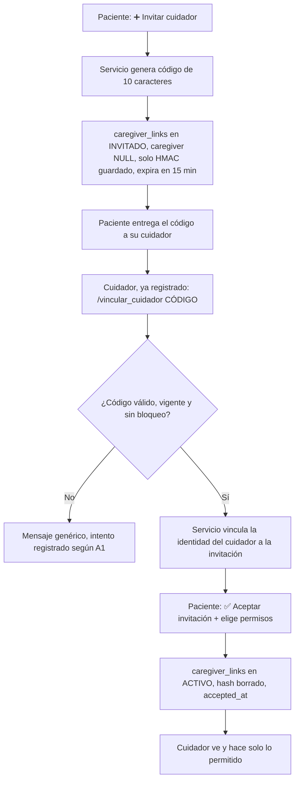
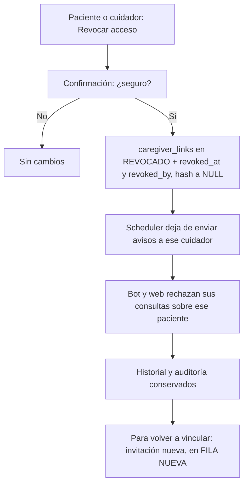

# RELACIONES PACIENTE–CUIDADOR — DosisAlerta

Diseño del modelo de datos para familiares y cuidadores en la
versión 1. Documento de diseño, no implementación: no crea
modelos, migraciones ni tablas.

Estado: 2026-11-11, **versión auditada y cerrada**. Decisión
oficial aprobada por el líder del proyecto: los cuidadores están
incluidos en la v1. Un paciente puede vincular uno o varios
cuidadores autorizados y un cuidador puede estar vinculado a uno
o varios pacientes, siempre mediante autorización explícita.
Este documento es la entrada de diseño para la Fase 2: las tres
tablas nuevas se crean junto a las 11 originales, con una
separación entre diseño y migración (ver §12): `caregiver_links`
y `caregiver_audit_log` en la migración inicial de la Fase 2;
`caregiver_link_attempts` en una migración de la Fase 6.

**Auditoría final 2026-11-11.** Esta versión incorpora las
correcciones de la auditoría técnica final: el cuidador es
desconocido en el momento de la invitación (C1), la unicidad
permite revincular con fila nueva (C2), los límites de la
gestión cierran las puertas traseras a la dosis (C3) y la
auditoría admite eventos sin cuidador identificado (C4). Las
tres decisiones pendientes de la auditoría quedaron APROBADAS
el 2026-11-11: tabla 14 `caregiver_link_attempts` (A1), columna
`details JSONB` con minimización de datos (M3) e interpretación
estrecha de "gestionar horarios" (A4). Ver §12 y §13.

## 1. Las 11 tablas originales no cambian

El modelo original (`docs/database/MODELO_DATOS.md`) sigue intacto:

1. `users`
2. `medications`
3. `treatments`
4. `treatment_medications`
5. `medication_schedules`
6. `medication_reminders`
7. `medication_intakes`
8. `telegram_accounts`
9. `refresh_tokens`
10. `notification_logs`
11. `telegram_link_attempts`

Ninguna de las 11 se modifica para los cuidadores. La relación se
añade con **3 tablas nuevas** (total del modelo: 14 tablas):

12. `caregiver_links`
13. `caregiver_audit_log`
14. `caregiver_link_attempts` (antifraude; diseñada ahora, su
    migración física es de la Fase 6, ver §12 y §13)

## 2. Evaluación: ¿una tabla o varias?

Se evaluaron tres opciones:

| Opción | Veredicto |
|---|---|
| Una sola tabla `caregiver_links` (vínculo + permisos + invitación, sin auditoría separada) | **Insuficiente.** La auditoría es por operación (muchas filas por vínculo, solo de añadido, con retención propia). Guardarla en el vínculo es imposible sin perder historia. |
| Tres tablas: invitaciones, vínculos y auditoría separadas | **Innecesaria.** Una invitación es 1:1 con su vínculo como fila, pero con una corrección importante (C1): en el momento de invitar, el cuidador aún no está identificado, así que la fila INVITADO lleva `caregiver_user_id` NULL hasta que el cuidador presenta el código. Separar la invitación en su propia tabla añadiría una tabla y una unión por cada operación sin ningún caso de uso que lo exija (no hay varias invitaciones pendientes por pareja conocida). |
| **Dos tablas: `caregiver_links` + `caregiver_audit_log`** | **Elegida.** El vínculo lleva invitación, estado y los 8 permisos; la auditoría vive aparte, como `notification_logs` y `telegram_link_attempts` ya hacen en el modelo original. |

Los permisos son 8 columnas booleanas en `caregiver_links`, no
una tabla aparte: el conjunto de permisos es fijo y conocido (ver
§4); una tabla de permisos solo se justificaría si los permisos
fueran extensibles por el usuario, que no es el caso.

La tercera tabla, `caregiver_link_attempts`, no es una tabla de
negocio sino de seguridad, espejo de `telegram_link_attempts`:
los intentos fallidos de invitación se registran por `chat_id`,
incluso cuando el código intentado no corresponde a ninguna
invitación existente, y por eso no pueden vivir en
`caregiver_links` (ver §13).

## 3. Diagrama entidad-relación

```mermaid
erDiagram
    users ||--o{ caregiver_links : "es paciente en"
    users ||--o{ caregiver_links : "es cuidador en"
    users ||--o{ caregiver_audit_log : "actúa como cuidador"
    users ||--o{ caregiver_audit_log : "es paciente auditado"
    caregiver_links ||--o{ caregiver_audit_log : "genera"
    caregiver_link_attempts : "sin FK a users (se registra por chat_id, incluso sin invitación conocida; ver §13)"
    users ||--o{ telegram_accounts : "vincula"
    users ||--o{ medications : "posee"
    users ||--o{ treatments : "posee"
    caregiver_links {
        BIGINT id PK
        BIGINT patient_user_id FK
        BIGINT caregiver_user_id FK_NULL
        VARCHAR status
        VARCHAR invite_code_hash
        TIMESTAMPTZ invite_expires_at
        BOOLEAN perm_view_medications
        BOOLEAN perm_view_treatments
        BOOLEAN perm_view_schedules
        BOOLEAN perm_view_upcoming
        BOOLEAN perm_view_history
        BOOLEAN perm_receive_notifications
        BOOLEAN perm_manage_medications
        BOOLEAN perm_manage_schedules
    }
    caregiver_audit_log {
        BIGINT id PK
        BIGINT caregiver_user_id FK_NULL
        BIGINT patient_user_id FK
        VARCHAR action
        VARCHAR target_type
        BIGINT target_id
        VARCHAR result
        TIMESTAMPTZ created_at
    }
```

Cardinalidades:

- Un paciente (`users`) tiene 0..N vínculos como paciente; un
  cuidador (`users`) tiene 0..N vínculos como cuidador. Relación
  muchos a muchos entre usuarios, mediante `caregiver_links`.
- Un vínculo tiene 0..N filas de auditoría; cada fila de auditoría
  pertenece a exactamente un vínculo (por la pareja
  paciente–cuidador, no por FK directa al vínculo: ver §5.2).
- Un cuidador recibe notificaciones solo si tiene
  `telegram_accounts` en estado `VINCULADA` (su propia cuenta de
  Telegram vinculada, RF15).

## 4. Tabla 12: `caregiver_links`

| Columna | Tipo | Restricción |
|---|---|---|
| id | BIGINT | PK |
| patient_user_id | BIGINT | NOT NULL, FK → users.id |
| caregiver_user_id | BIGINT | **NULL hasta que el cuidador presenta el código** (C1); NOT NULL cuando el vínculo está ACTIVO (CHECK); FK → users.id |
| status | VARCHAR(20) | NOT NULL, CHECK IN ('INVITADO','ACTIVO','REVOCADO') |
| invite_code_hash | VARCHAR(64) | NULL, solo mientras está INVITADO (HMAC-SHA256 del código con `CAREGIVER_LINK_SECRET`; ver §6). A NULL al aceptar, revocar o invalidar, en la misma transacción que cambia el estado |
| invite_expires_at | TIMESTAMPTZ | NULL, solo mientras está INVITADO |
| failed_attempts | INTEGER | NOT NULL, DEFAULT 0 (intentos fallidos sobre el código vigente **cuando el código coincide con el hash**; ver §6.3 y A1) |
| last_failed_at | TIMESTAMPTZ | NULL |
| perm_view_medications | BOOLEAN | NOT NULL, DEFAULT FALSE |
| perm_view_treatments | BOOLEAN | NOT NULL, DEFAULT FALSE |
| perm_view_schedules | BOOLEAN | NOT NULL, DEFAULT FALSE |
| perm_view_upcoming | BOOLEAN | NOT NULL, DEFAULT FALSE |
| perm_view_history | BOOLEAN | NOT NULL, DEFAULT FALSE |
| perm_receive_notifications | BOOLEAN | NOT NULL, DEFAULT FALSE |
| perm_manage_medications | BOOLEAN | NOT NULL, DEFAULT FALSE |
| perm_manage_schedules | BOOLEAN | NOT NULL, DEFAULT FALSE |
| invited_at | TIMESTAMPTZ | NOT NULL |
| invited_by | BIGINT | NOT NULL, FK → users.id (normalmente = patient_user_id) |
| accepted_at | TIMESTAMPTZ | NULL, NOT NULL cuando ACTIVO |
| revoked_at | TIMESTAMPTZ | NULL, NOT NULL cuando REVOCADO |
| revoked_by | BIGINT | NULL, FK → users.id (quién revocó: paciente o cuidador) |
| created_at / updated_at | TIMESTAMPTZ | NOT NULL |

### 4.1. Restricciones

- **Unicidad de vínculos no revocados (C2, decisión 1).** No
  hay UNIQUE simple por pareja: al revocar y volver a invitar
  se crea **una fila nueva** y la anterior queda REVOCADA con
  su historia intacta. La unicidad se impone con un índice
  único parcial (ver §4.2): como máximo una fila no revocada
  por pareja.
- `CHECK (patient_user_id <> caregiver_user_id)`: nadie es su
  propio cuidador. (Con `caregiver_user_id` NULL el CHECK no se
  evalúa: en PostgreSQL un CHECK con NULL no falla, y la fila
  INVITADO anónima no necesita esta comprobación.)
- **Máquina de estados (CHECKs):**
  - `status = 'ACTIVO'` exige `caregiver_user_id IS NOT NULL`,
    `accepted_at IS NOT NULL`, `invite_code_hash IS NULL` e
    `invite_expires_at IS NULL`.
  - `status = 'REVOCADO'` exige `revoked_at IS NOT NULL`,
    `invite_code_hash IS NULL` e `invite_expires_at IS NULL`.
  - `status = 'INVITADO'` exige `accepted_at IS NULL` y
    `revoked_at IS NULL`.
- `CHECK (perm_manage_medications = FALSE OR perm_view_medications = TRUE)`:
  gestionar medicamentos exige poder verlos.
- `CHECK (perm_manage_schedules = FALSE OR perm_view_schedules = TRUE)`:
  gestionar horarios exige poder verlos.
- Estados: `INVITADO` (código pendiente), `ACTIVO` (aceptado por
  el paciente), `REVOCADO` (revocado por paciente o cuidador).
  No hay vuelta de `REVOCADO` a `ACTIVO`: hace falta una
  invitación nueva, en una fila nueva.

### 4.2. Índices

```sql
-- Como máximo un vínculo no revocado por pareja (C2).
-- Permite varias filas REVOCADO para la misma pareja (historial).
CREATE UNIQUE INDEX uq_caregiver_active_pair
  ON caregiver_links(patient_user_id, caregiver_user_id)
  WHERE status <> 'REVOCADO';

-- Como máximo una invitación pendiente por pareja ya conocida.
CREATE UNIQUE INDEX uq_caregiver_pending_pair
  ON caregiver_links(patient_user_id, caregiver_user_id)
  WHERE status = 'INVITADO' AND caregiver_user_id IS NOT NULL;

CREATE INDEX idx_caregiver_by_caregiver
  ON caregiver_links(caregiver_user_id, status);
CREATE INDEX idx_caregiver_by_patient
  ON caregiver_links(patient_user_id, status);

-- Localizar la invitación cuando el cuidador envía el código.
CREATE INDEX idx_caregiver_invite_hash
  ON caregiver_links(invite_code_hash)
  WHERE status = 'INVITADO';
```

Notas:

- En PostgreSQL, los NULL no se consideran iguales en un índice
  UNIQUE: varias filas INVITADO con `caregiver_user_id` NULL
  (invitaciones anónimas del mismo paciente, con códigos
  distintos) pueden coexistir. Es lo correcto: el paciente
  puede invitar a dos cuidadores a la vez.
- Si el paciente genera un código nuevo mientras hay una
  invitación INVITADO anónima vigente, no se hace INSERT (el
  paciente ya tiene una invitación pendiente con ese código
  distinto): se actualiza la fila INVITADO existente con el
  código nuevo, nueva expiración y `failed_attempts = 0`. Solo
  tras REVOCADO se crea fila nueva.

## 5. Tabla 13: `caregiver_audit_log`

| Columna | Tipo | Restricción |
|---|---|---|
| id | BIGINT | PK |
| caregiver_user_id | BIGINT | **NULL en eventos del ciclo de invitación sin cuidador identificado** (C4); FK → users.id |
| patient_user_id | BIGINT | NOT NULL, FK → users.id |
| action | VARCHAR(50) | NOT NULL (ver lista abajo) |
| target_type | VARCHAR(50) | NULL (p. ej. 'medication', 'schedule', 'reminder', 'treatment') |
| target_id | BIGINT | NULL |
| result | VARCHAR(20) | NOT NULL, CHECK IN ('OK','DENEGADO') |
| created_at | TIMESTAMPTZ | NOT NULL, DEFAULT now() (lo pone el servidor, nunca el cliente) |

Acciones registradas (lista inicial, ampliable solo con decisión
documentada): `INVITE_CREATED`, `INVITE_CODE_INVALIDATED`,
`INVITE_ACCEPTED`, `VIEW_MEDICATIONS`, `VIEW_TREATMENTS`,
`VIEW_SCHEDULES`, `VIEW_UPCOMING`, `VIEW_HISTORY`,
`RECEIVE_NOTIFICATION`, `MANAGE_MEDICATION_CREATE`,
`MANAGE_MEDICATION_UPDATE`, `MANAGE_MEDICATION_DEACTIVATE`,
`MANAGE_SCHEDULE_CREATE`, `MANAGE_SCHEDULE_UPDATE`,
`PERMISSION_GRANTED`, `PERMISSION_REVOKED`, `REVOKED`,
`ACCESS_DENIED`.

**Disciplina de solo añadido.** La aplicación solo hace INSERT
en esta tabla: ningún servicio hace UPDATE ni DELETE sobre ella.
La historia no se reescribe. (Como refuerzo opcional en una fase
posterior, se puede revocar UPDATE/DELETE al rol de la aplicación;
no es requisito de la Fase 2.)

### 5.1. Por qué no hay FK al vínculo ni al objetivo

- Sin FK a `caregiver_links`: si el vínculo se revoca, la
  auditoría debe conservarse. Una FK con borrado en cascada la
  destruiría y una FK simple impediría revocar con historia.
  La pareja (`caregiver_user_id`, `patient_user_id`) identifica
  el vínculo sin depender de su fila. Con la decisión 1 (fila
  nueva al revincular), la auditoría de un vínculo revocado
  sigue intacta y no se mezcla con la del vínculo nuevo.
- Sin FK a `target_id`: el objetivo puede ser de varios tipos
  (medicamento, horario, recordatorio). Es una referencia
  polimórfica intencionada, como es habitual en auditoría; el
  servicio valida el objetivo antes de registrarlo.

### 5.2. Índices

```sql
CREATE INDEX idx_caregiver_audit_patient
  ON caregiver_audit_log(patient_user_id, created_at DESC);
CREATE INDEX idx_caregiver_audit_caregiver
  ON caregiver_audit_log(caregiver_user_id, created_at DESC);
```

El paciente consulta "quién hizo qué sobre mis datos" por el
primer índice; el segundo sirve para revisar la actividad de un
cuidador concreto.

### 5.3. Columna `details JSONB` — APROBADO 2026-11-11 (M3)

Los cambios de permisos (qué permiso, valor anterior y nuevo)
no caben en `target_id` (BIGINT). La tabla lleva
`details JSONB NULL` para el dato estructurado extra
(p. ej. `{"permission": "perm_view_history", "old": false,
"new": true}`).

**Política de minimización de datos (obligatoria).** En
`details` solo cabe lo mínimo necesario para entender la
acción auditada:

- Permitido: el nombre del permiso que cambió y sus valores
  anterior y nuevo (booleanos); el nombre del campo que cambió
  en una gestión (p. ej. `"field": "times"`); y, cuando el
  cambio auditable es ese campo, sus valores anterior y nuevo
  (p. ej. las horas de un horario).
- **Prohibido siempre:** tokens, secretos, códigos de
  invitación (ni en texto plano ni su hash), contraseñas,
  dosis, concentraciones, nombres de medicamentos, indicaciones
  médicas y cualquier información clínica que no sea el propio
  cambio auditado.

Si un dato no está en la lista de permitidos, no se guarda en
`details`: se registra la acción sin él. La revisión de la
Fase 4 debe comprobar con una prueba que ningún `details`
contiene un token, un secreto o un código.

## 6. Permisos

### 6.1. Los 8 permisos independientes — APROBADO 2026-11-11

| Permiso | Columna | Qué permite |
|---|---|---|
| Consultar medicamentos | `perm_view_medications` | Ver la lista y el detalle de los medicamentos del paciente |
| Consultar tratamientos | `perm_view_treatments` | Ver tratamientos y sus estados |
| Consultar horarios | `perm_view_schedules` | Ver los horarios de cada medicamento |
| Consultar próximas tomas | `perm_view_upcoming` | Ver los próximos recordatorios ordenados |
| Consultar historial | `perm_view_history` | Ver tomas, perdidas, pospuestas y cumplimiento |
| Recibir notificaciones autorizadas | `perm_receive_notifications` | Recibir el aviso cuando el paciente no confirma en la ventana de gracia (30 min). El aviso al cuidador es **informativo, sin botones de acción**: no incluye YA LO TOMÉ ni RECORDARME DESPUÉS |
| Gestionar medicamentos | `perm_manage_medications` | Crear medicamentos y editar nombre, presentación y notas (ver límites en §6.2) |
| Gestionar horarios | `perm_manage_schedules` | Editar horarios dentro de los tratamientos existentes (ver límites en §6.2 y A4) |

Todos empiezan en `FALSE`. Cada uno se concede explícitamente
por el paciente, por separado, y se puede revocar por separado
sin tocar los demás ni revocar el vínculo entero.

### 6.2. Límites de la gestión — APROBADO 2026-11-11, con cierres de auditoría

La gestión del cuidador **no** le permite, en ningún caso:

- Modificar dosis prescritas por iniciativa propia. La dosis
  vive en `treatment_medications.dose_amount` y `dose_unit`:
  el cuidador no puede escribir en esa tabla. Cualquier intento
  devuelve 403.
- Cambiar indicaciones médicas (`treatments.notes`,
  `treatment_medications.instructions`).
- Suspender tratamientos por decisión propia. Cambiar el estado
  de un tratamiento (`ACTIVO`/`PAUSADO`/`COMPLETADO`/`CANCELADO`)
  está prohibido para el cuidador: el servicio lo rechaza
  siempre, aunque tenga permisos de gestión.
- Acceder a pacientes que no lo hayan autorizado.
- Confirmar tomas en nombre del paciente: **no hay permiso de
  confirmación** en la lista aprobada. El cuidador no registra
  tomas; solo el paciente confirma las suyas (web o Telegram).
- Añadir medicamentos a un tratamiento: eso es escribir en
  `treatment_medications` y ningún permiso lo cubre. Solo el
  paciente añade o quita medicamentos de sus tratamientos.

**Cierres de auditoría (C3): la gestión no puede usarse para
modificar la dosis por la puerta de atrás.**

- **Concentración:** `medications.concentration` ("500 mg") es
  lo que se muestra como dosis en las pantallas y en los avisos.
  El cuidador **no puede editar `concentration` ni `unit`**
  (403 siempre). Con `perm_manage_medications` solo puede crear
  medicamentos nuevos y editar `name`, `presentation` y
  `notes`.
- **Desactivación:** el cuidador solo puede desactivar
  (`is_active = FALSE`) un medicamento que **no esté en ningún
  `treatment_medication` activo de un tratamiento ACTIVO**.
  Desactivar un medicamento en tratamiento silenciaría sus
  recordatorios, que es suspender el tratamiento por la puerta
  de atrás. Si está en tratamiento activo, 403.
- **Horarios (A4, interpretación estrecha APROBADA
  2026-11-11):** cambiar `frequency`, `days_of_week` o
  `interval_days` cambia el régimen prescrito, que es parte de
  la indicación médica. Con `perm_manage_schedules` el cuidador
  **solo edita las horas** (`times`) de horarios ya existentes,
  con autorización explícita. **No puede crear horarios ni
  cambiar frecuencia, días de la semana o intervalos.** Esas
  operaciones las hace solo el paciente. Cada cambio de horario
  queda en `caregiver_audit_log`.
- **Confirmar y posponer tomas:** no existe ninguna operación
  que permita al cuidador confirmar o posponer una toma. Si un
  cuidador pulsa YA LO TOMÉ o RECORDARME DESPUÉS sobre un
  recordatorio del paciente (por ejemplo, desde un mensaje
  reenviado), el servicio lo rechaza con 403 y lo registra como
  `ACCESS_DENIED`. El aviso que recibe el cuidador no lleva
  botones, precisamente para que este caso no se produzca por
  error.

### 6.3. Flujo de invitación y aceptación



Reglas del código (las mismas que la vinculación de Telegram,
RF15, `MODELO_DATOS.md` §7.3):

- 10 caracteres, alfabeto de 32 sin confusiones, módulo
  `secrets`, expiración 15 minutos, un solo uso.
- Solo se guarda el HMAC-SHA256 con el secreto independiente
  **`CAREGIVER_LINK_SECRET`** (decisión 2, 2026-11-11; distinto
  de `TELEGRAM_LINK_SECRET` y de `JWT_SECRET`; se añade a `.env`
  y a `.env.example` como nombre de variable, sin valores reales,
  en la Fase 2). Se compara con `hmac.compare_digest`. Nunca se
  guarda el código en texto plano, nunca va en logs y nunca se
  devuelve por API.
- Al aceptar, revocar o invalidar, `invite_code_hash` e
  `invite_expires_at` pasan a NULL **en la misma transacción**
  que cambia el estado (igual que `telegram_accounts`, §7.3).
  Un código expirado no se puede "reactivar".
- **Vincular la identidad (C1):** cuando el cuidador presenta
  el código, el servicio hace
  `UPDATE caregiver_links SET caregiver_user_id = ?
  WHERE invite_code_hash = ? AND status = 'INVITADO'
  AND caregiver_user_id IS NULL` y exige exactamente una fila
  afectada. Si dos personas presentan el mismo código a la vez,
  solo gana una; la otra recibe el mensaje genérico.
- **Límite de intentos (A1, tabla 14 APROBADA):** cada intento
  (éxito o fallo) se registra en `caregiver_link_attempts` (ver
  §13), con el `chat_id`, el hash del código intentado y el
  motivo. El contador `failed_attempts` del vínculo solo se
  puede incrementar cuando el código **coincide** con el hash
  guardado (código correcto pero vencido, ya usado o revocado):
  un código incorrecto no se puede atribuir a ningún vínculo.
  5 fallos sobre el código vigente lo invalidan (hash a NULL;
  el paciente genera otro código). El límite por `chat_id`
  (5 fallos en 15 minutos, bloqueo 15 minutos) se aplica
  consultando `caregiver_link_attempts`: sin esa tabla, la
  protección contra fuerza bruta es incompleta.
- Mensaje genérico ante cualquier fallo (código inexistente,
  vencido, usado o bloqueado devuelven lo mismo), para no
  confirmar al atacante qué códigos existen.
- El código identifica la invitación, no al cuidador: el vínculo
  no queda `ACTIVO` hasta la aceptación explícita del paciente
  (paso I). Que el cuidador tenga el código no basta.

### 6.4. Flujo de revocación y revinculación



- Revocar un permiso individual: el booleano pasa a `FALSE`
  sin tocar el vínculo; la revocación es inmediata (la siguiente
  consulta ya lo ve denegado) y queda en auditoría.
- Revocar el vínculo: `status = 'REVOCADO'` con fecha y autor,
  hash a NULL en la misma transacción. No borra el historial ni
  la auditoría. No hay vuelta de `REVOCADO` a `ACTIVO`.
- **Revinculación (decisión 1):** si el paciente vuelve a
  invitar al mismo cuidador, se crea **una fila nueva** de
  `caregiver_links`. La fila REVOCADO anterior queda intacta
  con toda su historia y su auditoría. El índice único parcial
  (§4.2) permite varias filas REVOCADO para la misma pareja y
  una sola no revocada.

## 7. Ejemplos de autorización

**Ejemplo 1 — Hija que acompaña a su padre.**
Permisos: ver medicamentos, ver tratamientos, ver horarios, ver
próximas tomas, ver historial y recibir notificaciones. Gestión:
ninguna. Si el padre no confirma una toma en 30 minutos, la hija
recibe el aviso; no puede cambiar nada.

**Ejemplo 2 — Esposa que gestiona los horarios.**
Permisos: los 6 de lectura y notificaciones, más gestionar
horarios. Puede mover la toma de las 08:00 a las 08:30 en un
horario existente, pero no puede cambiar la dosis de 500 mg,
ni la frecuencia del tratamiento, ni suspenderlo.

**Ejemplo 3 — Cuidador revocado parcialmente.**
El paciente quita solo "gestionar horarios" a su cuidador. El
cuidador sigue viendo las próximas tomas y recibiendo avisos,
pero al intentar editar un horario recibe 403 y el intento queda
en `caregiver_audit_log` como `DENEGADO`.

**Ejemplo 4 — Revinculación.**
El paciente revoca a su hija en enero (fila 1 REVOCADO, con su
auditoría). En marzo la vuelve a invitar: se crea la fila 2
(INVITADO → ACTIVO). La auditoría de enero sigue en la fila 1
y no se mezcla con la de marzo.

## 8. Prevención de accesos cruzados

Defensa en dos capas, igual que el modelo original
(`MODELO_DATOS.md` §7):

**Capa 1 — Servicio (siempre).** Antes de cualquier lectura o
escritura como cuidador, el servicio resuelve el vínculo por
(`caregiver_user_id` = usuario actual, `patient_user_id` =
paciente pedido) y exige `status = 'ACTIVO'` y el permiso
concreto de esa operación. Sin vínculo, sin permiso o con el
vínculo revocado: 403 y registro `ACCESS_DENIED` en auditoría.
El `user_id` nunca viene del cliente: sale del token (web) o del
`chat_id` vinculado (bot).

**Capa 1b — Validación en el backend en cada operación
(decisión 3).** Los permisos se validan en el servicio, en cada
operación, sin excepción. La interfaz (web o bot) nunca es la
única barrera: ocultar un botón no autoriza nada. Concretamente:

- Los permisos **no** se guardan en el JWT, en la sesión ni en
  el `callback_data`. Cada operación vuelve a leer el vínculo.
- El `callback_data` del bot solo lleva `reminder_id` y acción
  (D-BOT-12): el paciente se resuelve desde el recordatorio y
  el vínculo se comprueba en ese momento. Un `reminder_id` de
  otro paciente devuelve 403.
- Un permiso revocado a mitad de una sesión se nota en la
  siguiente operación, no al cerrar sesión.
- Pruebas obligatorias en la Fase 4 (una por permiso): cada
  operación sin su permiso devuelve 403; cada operación con el
  permiso pero con el vínculo REVOCADO devuelve 403; cada
  operación sobre un paciente sin vínculo devuelve 403.

**Capa 2 — Base de datos (red de seguridad).** Las FK compuestas
`(padre_id, user_id)` de las 11 tablas originales impiden mezclar
el tratamiento de un paciente con el medicamento de otro, aunque
el servicio tuviera un error. `caregiver_links` añade sus propias
FK a `users` por ambos lados y los índices únicos parciales por
pareja, de modo que no existe un vínculo que apunte a un usuario
inexistente ni dos vínculos no revocados duplicados.

**Aislamiento por `user_id`.** Se conserva tal cual: el cuidador
no tiene un `user_id` propio sobre los datos del paciente; actúa
siempre *a través* del vínculo, con el `patient_user_id` del
paciente como filtro de cada consulta. Ninguna consulta del
cuidador se ejecuta sin ese filtro.

## 9. Seguridad

- El código de invitación sigue las mismas reglas que la
  vinculación de Telegram (RF15): `secrets`, HMAC-SHA256 con
  secreto propio (`CAREGIVER_LINK_SECRET`), 15 minutos, un solo
  uso, límites de intentos, mensaje genérico.
- El cuidador debe ser usuario registrado; para recibir avisos
  por Telegram debe tener además su propia cuenta vinculada
  (RF15). Sin vínculo de Telegram propio, puede consultar por la
  web pero no recibe avisos por Telegram.
- Los datos de salud no van en logs, URLs ni mensajes de error
  (RNF08). La auditoría registra quién hizo qué y sobre qué
  registro, no el contenido clínico.
- Las revocaciones son inmediatas: no hay cachés de permisos que
  sobrevivan a la revocación. Cada operación vuelve a resolver
  el vínculo.
- La IA (Fase 10) solo usa información autorizada por estos
  permisos: no puede ampliarlos, ni exponer datos de otros
  pacientes, ni enviar información clínica identificable a
  proveedores externos sin evaluación y autorización (ver
  `docs/architecture/MODULO_IA.md` §3).

## 10. Transacciones y concurrencia (recomendaciones para la Fase 2/4/6)

- **Aceptar invitación:** una sola transacción que (a) actualiza
  el vínculo a `ACTIVO` con `WHERE status = 'INVITADO'` y pone
  el hash a NULL, (b) inserta la fila `INVITE_ACCEPTED` en la
  auditoría. Si la transacción afecta a 0 filas, la invitación
  ya no estaba pendiente: 409, no un error 500.
- **Vincular identidad (presentar el código):** `UPDATE ...
  WHERE invite_code_hash = ? AND status = 'INVITADO' AND
  caregiver_user_id IS NULL`, con la expiración comprobada en
  el mismo `WHERE` (`invite_expires_at > now()`), no en el
  código de la aplicación antes de la actualización. Solo una
  fila puede ganar la carrera.
- **Revocar:** `UPDATE ... SET status = 'REVOCADO', hash = NULL
  WHERE id = ? AND status = 'ACTIVO'` (o `INVITADO`), en la
  misma transacción que la fila de auditoría. Una revocación
  concurrente con una aceptación no puede dejar el vínculo en
  dos estados: una de las dos transacciones afecta a 0 filas.
- **Invitar de nuevo (mismo paciente, mismo código nuevo):**
  `UPDATE` de la fila INVITADO anónima, no `INSERT`.
- **Contadores de intentos:** incremento atómico
  (`failed_attempts = failed_attempts + 1` en la misma
  `UPDATE`), nunca leer-sumar-escribir desde la aplicación.
- **Scheduler y avisos al cuidador:** el scheduler vuelve a
  comprobar vínculo `ACTIVO` + `perm_receive_notifications` +
  `telegram_accounts` VINCULADA del cuidador inmediatamente
  antes de enviar. Un aviso ya en vuelo no se puede retirar:
  ese caso queda documentado como aceptado (la ventana es de
  milisegundos y el aviso ya salió).
- **Confirmar una toma dos veces:** ya cubierto por el modelo
  original (UNIQUE en `medication_intakes.reminder_id` + la
  transición de estado en el servicio).

## 11. Compatibilidad con PostgreSQL 17, SQLAlchemy async y Alembic

- Índices únicos parciales (`WHERE status <> 'REVOCADO'`):
  soportados por PostgreSQL 17 y por SQLAlchemy 2.0 async
  (`postgresql_where`). En Alembic se escriben como operaciones
  explícitas `op.create_index(..., postgresql_where=...)`:
  **el autogenerate no detecta bien los cambios en índices
  parciales**, así que la migración inicial debe escribirlos a
  mano y la prueba de la Fase 2 debe verificarlos.
- CHECKs, `TIMESTAMPTZ`, `INTEGER[]`, `TIME[]`, `JSONB` y
  `NUMERIC(10,3)`: todo soportado sin cambios.
- `caregiver_user_id` NULLABLE con FK: permitido; las FK con
  NULL simplemente no se comprueban para esa fila.
- La columna propuesta `details JSONB` (§5.3) también es
  compatible; si se aprueba, se añade en su propia migración.

## 12. Qué decide la Fase 2 y qué queda abierto

**Decidido para la Fase 2 (2026-11-11):**

- Las tablas nuevas, sus columnas, restricciones e índices de
  este documento entran en las migraciones junto a las 11
  originales (total del modelo: 14 tablas).
- Secreto independiente `CAREGIVER_LINK_SECRET` (decisión 2).
- Revinculación con fila nueva, nunca reactivar la anterior
  (decisión 1).
- Validación de permisos en el backend en cada operación; la
  interfaz nunca es la única barrera (decisión 3).
- `CAREGIVER_LINK_SECRET` se añade como nombre de variable a
  `.env` y `.env.example` en la Fase 2, sin valores reales.

**Separación entre diseño y migración (aprobado 2026-11-11):**

- **Migración inicial de la Fase 2 (13 tablas):** las 11
  originales + `caregiver_links` + `caregiver_audit_log`
  (con su columna `details JSONB`).
- **Migración de la Fase 6 (1 tabla):** `caregiver_link_attempts`.
  Su estructura queda documentada desde ahora (§13) porque la
  protección contra fuerza bruta forma parte del diseño, pero
  su creación física espera a la Fase 6: es la fase que instala
  el bot, el único proceso que recibe los códigos de invitación
  y, por tanto, el que escribe los intentos. La Fase 2 no se
  bloquea por ella: el servicio de vinculación de la Fase 6
  exige la tabla antes de aceptar códigos.
- La columna `details JSONB` (M3, aprobada) entra en la
  migración inicial de la Fase 2, con su política de
  minimización (§5.3).
- La interpretación estrecha de "gestionar horarios" (A4,
  aprobada) se implementa en la Fase 4.

**No decidido (no bloquea la Fase 2):**

- La pantalla exacta de invitación en la web y en el bot (Fase 6
  y Fase 8).
- El texto exacto del aviso al cuidador (Fase 5, con el motor).

## 13. Tabla 14: `caregiver_link_attempts` (antifraude) — APROBADA 2026-11-11

Espejo de `telegram_link_attempts` (`MODELO_DATOS.md` §3.11 y
§4): sin una tabla, el límite de intentos por `chat_id`
dependería de memoria que se pierde al reiniciar el bot, y un
atacante podría probar códigos sin dejar rastro. Es una tabla
de seguridad, no de negocio.

| Columna | Tipo | Restricción |
|---|---|---|
| id | BIGINT | PK |
| chat_id | BIGINT | NOT NULL (quien intentó, aunque no esté vinculado ni la invitación exista) |
| telegram_user_id | BIGINT | NULL (si Telegram lo proporciona) |
| attempted_code_hash | VARCHAR(64) | NULL (HMAC-SHA256 del código intentado, para auditar sin guardar códigos) |
| success | BOOLEAN | NOT NULL |
| attempted_at | TIMESTAMPTZ | NOT NULL |
| reason | VARCHAR(50) | NULL (ej. 'INVALIDO', 'VENCIDO', 'LIMITADO', 'REVOCADO'; nunca distingue más de lo necesario en el mensaje al usuario) |

### 13.1. Por qué esta tabla identifica fallos sin conocer el código correcto

El intento se registra **antes** de saber si el código es
correcto, con el hash del código que el atacante escribió
(`attempted_code_hash`) y el `chat_id` desde el que llegó. El
límite no necesita conocer el código correcto: se cuenta por
identidad del chat y ventana temporal, no por invitación:

- **Límite por chat:** si un mismo `chat_id` acumula **5
  fallos en 15 minutos**, se bloquean nuevos intentos desde
  ese chat durante 15 minutos. La consulta es un conteo sobre
  `(chat_id, attempted_at)`, no una búsqueda por código.
- **Invalidación por código:** un código concreto que acumule
  5 fallos se invalida. Esto solo se puede contar cuando el
  hash intentado coincide con el hash guardado de una
  invitación vigente (código correcto pero vencido, ya usado o
  revocado): en ese caso el fallo se atribuye al vínculo y su
  `failed_attempts` se incrementa. Un código incorrecto no se
  atribuye a ningún vínculo; lo frena el límite por chat.
- **Sin oráculo:** el mensaje al usuario es el mismo ante
  código inexistente, vencido, ya usado o bloqueado.

### 13.2. Carreras entre API y bot

- API y bot escriben en la misma tabla, pero solo con INSERT:
  no hay contadores compartidos en memoria ni lecturas con
  escritura posterior. Cada intento es una fila nueva; el
  límite se calcula con un conteo en ventana.
- La carrera comprobar-límite-luego-insertar puede dejar pasar
  uno o dos intentos extra si dos procesos consultan a la vez:
  es aceptable y está documentado. El espacio de códigos es de
  50 bits y la expiración es de 15 minutos: un exceso de uno o
  dos intentos no hace viable adivinar un código. Lo que no
  puede haber es un exceso sin límite: el conteo se hace en
  cada intento, no en cada sesión.
- `failed_attempts` de `caregiver_links` se incrementa de forma
  atómica (`failed_attempts = failed_attempts + 1` en la misma
  UPDATE), nunca con leer-sumar-escribir desde la aplicación.

### 13.3. Índices y conservación

```sql
CREATE INDEX idx_caregiver_attempts_chat
  ON caregiver_link_attempts(chat_id, attempted_at DESC);
CREATE INDEX idx_caregiver_attempts_hash
  ON caregiver_link_attempts(attempted_code_hash, attempted_at DESC);
```

Los intentos de más de 24 horas se ignoran para el límite y
pueden purgarse en una tarea de limpieza (Fase 6); no son
historial clínico y no necesitan conservarse indefinidamente.
Nunca `DELETE` en `caregiver_links` ni en
`caregiver_audit_log` desde la aplicación.
