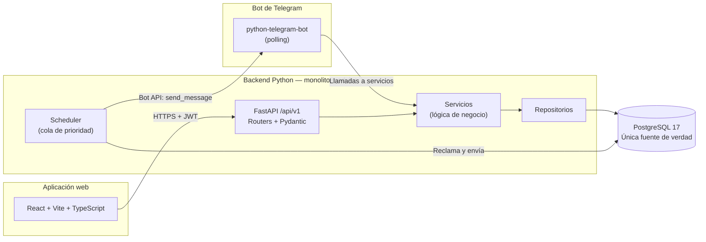
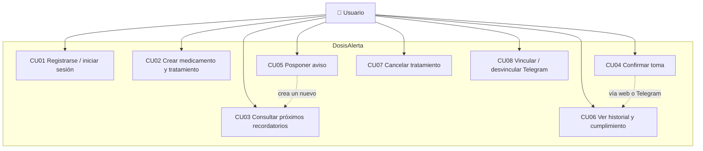
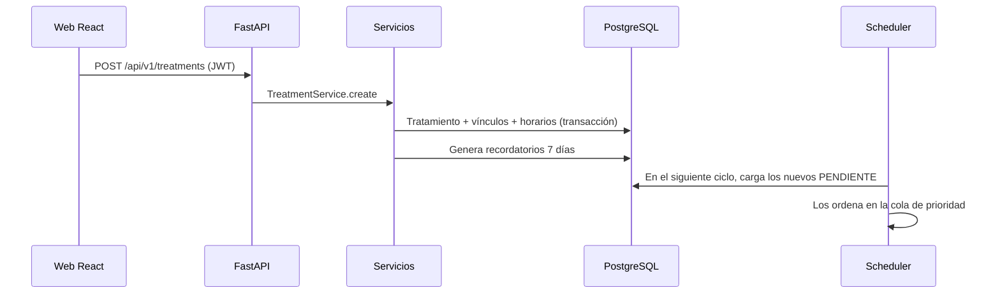
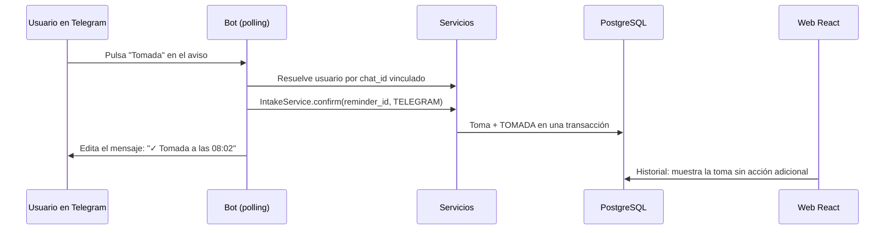

# DIAGRAMAS — DosisAlerta

Fase 0. Los diagramas están en Mermaid (texto), no en imágenes: se
pueden versionar, revisar en un diff y renderizar en GitHub, en
editores y en la documentación. Si un diagrama contradice al modelo
de datos, manda el modelo y el diagrama se corrige.

## 1. Diagrama de arquitectura



Lectura: React y Telegram no se hablan entre sí. Ambos llegan, por
caminos distintos, a los mismos servicios y a la misma base de datos.

## 2. Diagrama entidad-relación

```mermaid
erDiagram
    users ||--o{ medications : "tiene"
    users ||--o{ treatments : "tiene"
    users ||--o| telegram_accounts : "vincula"
    users ||--o{ refresh_tokens : "tiene"
    users ||--o{ notification_logs : "recibe"
    treatments ||--o{ treatment_medications : "incluye"
    medications ||--o{ treatment_medications : "aparece en"
    treatment_medications ||--o{ medication_schedules : "tiene horarios"
    medication_schedules ||--o{ medication_reminders : "genera"
    treatment_medications ||--o{ medication_reminders : "origina"
    medication_reminders ||--o| medication_intakes : "se confirma en"
    medication_reminders ||--o{ medication_reminders : "se pospone en"
    medication_reminders ||--o{ notification_logs : "se envía y registra en"
    %% telegram_link_attempts no lleva FK a users: se registra por chat_id,
    %% incluso para intentos de chats no vinculados (ver MODELO_DATOS §3.11)

    users {
        bigint id PK
        string email UK
        string password_hash
        string timezone
    }
    medications {
        bigint id PK
        bigint user_id FK
        string name
    }
    treatments {
        bigint id PK
        bigint user_id FK
        string status
        date start_date
        date end_date
    }
    treatment_medications {
        bigint id PK
        bigint treatment_id FK
        bigint medication_id FK
        decimal dose_amount
    }
    medication_schedules {
        bigint id PK
        bigint treatment_medication_id FK
        string frequency
        time_array times
    }
    medication_reminders {
        bigint id PK
        bigint schedule_id FK
        timestamptz scheduled_at
        string status
        bigint parent_reminder_id FK
    }
    medication_intakes {
        bigint id PK
        bigint reminder_id FK_UK
        timestamptz taken_at
        string source
    }
    telegram_accounts {
        bigint id PK
        bigint user_id FK_UK
        bigint chat_id
        string status
    }
    refresh_tokens {
        bigint id PK
        bigint user_id FK
        string token_hash
    }
    notification_logs {
        bigint id PK
        bigint reminder_id FK
        uuid attempt_id
        timestamptz attempted_at
        timestamptz sent_at "NULL si no confirmado"
        bigint telegram_message_id
        string status "ENVIADA, FALLIDA, AMBIGUA"
    }
    telegram_link_attempts {
        bigint id PK
        bigint chat_id
        boolean success
        timestamptz attempted_at
    }
```

Detalle completo de columnas, tipos, restricciones e índices:
`docs/database/MODELO_DATOS.md`.

## 3. Diagrama de casos de uso



CU01–CU08 están definidos en `docs/architecture/REQUISITOS.md` §3.
El caso del sistema (CU09, recuperación tras reinicio) no tiene actor
humano y por eso no aparece aquí: está en el diagrama de flujo §4.

## 4. Flujo de notificaciones (incluye recuperación y duplicados)

```mermaid
sequenceDiagram
    participant GEN as Generador (Fase 4)
    participant DB as PostgreSQL
    participant SCH as Scheduler (API)
    participant TG as Telegram Bot API
    participant BOT as Bot (polling)
    participant WEB as Web React

    GEN->>DB: Crea recordatorios próximos 7 días<br/>(único por schedule_id + scheduled_at)
    SCH->>DB: Al arrancar: carga PENDIENTE,<br/>reconcilia ENVIANDO viejos, marca PERDIDA fuera de gracia
    SCH->>SCH: Cola de prioridad ordena por scheduled_at
    SCH->>DB: Reclama: PENDIENTE → ENVIANDO<br/>(transacción + attempt_id nuevo; solo quien reclama envía)
    SCH->>DB: Registra intento en notification_logs (attempted_at)
    SCH->>TG: send_message(chat_id, aviso + botones)
    alt Éxito
        TG-->>SCH: telegram_message_id
        SCH->>DB: Guarda message_id + sent_at en notification_logs<br/>y marca ENVIADA
    else Fallo claro de la API
        SCH->>DB: Marca intento FALLIDA (sent_at NULL),<br/>vuelve a PENDIENTE con backoff (máx. 3)
    else Respuesta perdida (ambiguo)
        SCH->>DB: Marca intento AMBIGUA (sent_at NULL),<br/>no reenvía de inmediato; reconciliación decide
    end
    BOT->>BOT: Usuario pulsa Tomada
    BOT->>DB: Vía IntakeService: crea toma + marca TOMADA<br/>(misma transacción, mismo servicio que la web)
    WEB->>DB: Al abrir Historial: lee la toma<br/>(origen TELEGRAM)
```

### 4.1. Flujo web → Telegram (creación)



### 4.2. Flujo Telegram → web (confirmación)



### 4.3. Qué pasa si algo falla (casos que la demo debe soportar)

| Fallo | Comportamiento diseñado |
|---|---|
| Telegram no responde al enviar (fallo claro) | Se registra `FALLIDA`, se libera la reclamación con `next_attempt_at` y backoff, máx. 3 intentos; luego queda visible como fallida, no silenciosa |
| Respuesta perdida tras enviar (ambiguo) | Se registra `AMBIGUA` con `sent_at` NULL; no se reenvía de inmediato. La reconciliación comprueba si ya hay `telegram_message_id`; si no, un único reintento tras 10 min; tras 3 ambiguos, `FALLIDA` |
| El servidor reinicia antes del envío | Al arrancar, los `PENDIENTE` se recargan en la cola; los `ENVIANDO` de más de 5 min se reconcilian (no se reenvían a ciegas) y los `ENVIADA` con `telegram_message_id` nunca se reenvían |
| El usuario pulsa Tomada dos veces | La segunda llamada encuentra el recordatorio ya en `TOMADA` y no crea una segunda toma (`reminder_id` UNIQUE en intakes) |
| Se cancela el tratamiento | Los `PENDIENTE` pasan a `CANCELADA` y se invalidan en la cola por versión; el historial queda intacto |
| Llega la hora y el usuario ya confirmó por la web | El scheduler encuentra el estado `TOMADA`, no `PENDIENTE`, y no envía el aviso |
